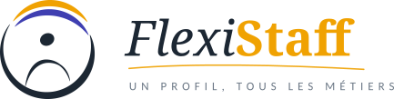

<!-- Alternate logo depending of darkmode on/off -->
<!-- Markdown command (without center image) -->
<!-- 

 
-->

<!-- HTML version with centered logo -->
<div align="center">
  <picture> 
    <source media="(prefers-color-scheme: dark)" srcset="./static/logo_white.png">
    
  </picture>
</div>

---

Cas pratique sur 3 jours pour la formation **Développeur IA** (École IA Brest - ISEN Ouest).

Votre mission : contribuer au développement d'une application qui permet de **photographier un planning**, d'en **extraire les créneaux** et de les **proposer à l'ajout dans un agenda partagé** (CalDAV).

```
 CVAT   →   YOLO   →   OCR   →   Parsing   →   CalDAV
annoter    détecter     lire      structurer     publier
```

> Le guide complet du cas pratique est distribué en formation. Ce README en est la version courte.

## Le contexte

FlexiStaff est une agence d'intérim (logistique, santé, BTP) : 12 agences, 340 intérimaires, 47 entreprises clientes, différents formats de planning. Chaque semaine, les gestionnaires ressaisissent à la main des plannings reçus en photo, en scan ou en PDF : 14 h par semaine et par agence, 1 créneau sur 12 erroné, 48 h de délai pour répercuter un changement.

| Dans le périmètre | Hors périmètre |
|---|---|
| ✓ Détecter les zones utiles sur la photo | ✗ Développer l'application mobile |
| ✓ En extraire le texte | ✗ Entraîner un moteur OCR |
| ✓ Reconstituer des créneaux structurés | |
| ✓ Les publier dans l'agenda (CalDAV) | |

## Les 3 jours

| Jour | Au programme | Livrables |
|---|---|---|
| **J1** | Labellisation (CVAT), préparation du dataset, premier entraînement YOLO **tracé dans MLflow** | Guide de labellisation, dataset exporté, premier run MLflow, premier modèle enregistré (« champion ») |
| **J2** | Test OCR sur le champion, évaluation, amélioration, challengers comparés au champion, promotion | Test OCR, challenger(s) comparé(s), promotion justifiée |
| **J3** | Parsing de la sortie OCR, publication CalDAV, démo dans l'application CalEvent | Parser testé, événements publiés sans doublon, démonstration |

## Infrastructure

### Les services déployés

Les services tournent sur une VM fournie par l'intervenant. Son adresse (`<IP_VM>`) vous est donnée en cours ; vos identifiants sont sur votre profil du portail.

| Service | Rôle | Port | URL |
|---|---|---|---|
| Portail | Connexion unique, identifiants, accès aux outils | 80 | `http://<IP_VM>/` |
| CVAT | Annotation des images | 8080 | `http://<IP_VM>:8080` |
| MLflow | Suivi des entraînements, registre de modèles (protégé par le portail) | 5000 | `http://<IP_VM>:5000` |
| RustFS (console) | Stockage S3, interface web | 9001 | `http://<IP_VM>:9001` |
| RustFS (API) | Stockage S3 | 9000 | `http://<IP_VM>:9000` |
| Radicale | Serveur CalDAV | 5232 | `http://<IP_VM>:5232/.web/` |
| CalEvent | Application de démonstration (jour 3, ouverte depuis le portail) | 8000 | `http://<IP_VM>:8000` (mobile : `/app`) |

Vous pouvez tester la connexion aux services :

```bash
curl -I http://<IP_VM>/                # Portail
curl -I http://<IP_VM>:8080            # CVAT
curl    http://<IP_VM>:5000/health     # MLflow -> 401 (identifiants requis)
curl    http://<IP_VM>:9000/health     # RustFS -> {"status":"ok",...}
curl -I http://<IP_VM>:5232/.web/      # Radicale
```

Une réponse, même un code 302 ou 401, prouve que le service est joignable.

> **Ne committez jamais d'identifiants** (mots de passe, clés) dans ce dépôt.

### Portail de formation

Afin de vous faciliter l'accès aux différents services, un portail a été mis en place : il regroupe des accès directs à chacun d'eux. Un identifiant et un mot de passe uniques vous permettront de vous connecter à chaque service qui le demande.

Le portail vous permet également de vous organiser en équipe, et regroupe les informations nécessaires pour connecter vos entraînements à MLflow.

## Organisation du travail

Chaque squad travaille dans **son propre fork** de ce dépôt : le fork est votre espace d'équipe.

```
flexistaff
├── docs/          # Documents du cas pratique (fournis par l'intervenant)
├── ressources/    # Ressources complémentaires publiées en cours de formation
├── static/        # Ressources statiques (images, logo…)
├── livrables/     # Vos livrables documentaires (guide de labellisation, comptes rendus…)
├── ai_training/   # Votre code d'entraînement (notebooks, scripts…)
├── dataset/       # Votre dataset local (non versionné, voir .gitignore)
├── OCR/           # Votre code OCR et parsing
├── .gitignore
└── README.md
```

> **Ne modifiez pas** `docs/`, `ressources/` ni `static/` : ces dossiers sont mis à jour par l'intervenant. Vous pourrez ainsi récupérer les mises à jour sans conflit.

Les modèles (`best.pt`, `best.onnx`) ne sont pas versionnés dans Git : ils sont **enregistrés dans MLflow**. Le dataset reste disponible sur CVAT.

### Récupérer les mises à jour

Des ressources pourront être ajoutées sur la branche `main` du dépôt d'origine pendant la formation. Pour les récupérer dans votre fork :

- **Depuis GitHub** : bouton **Sync fork** sur la page de votre fork, puis `git pull` en local.
- **En ligne de commande** :

```bash
git remote add upstream <URL_DU_DEPOT_ORIGINAL>   # une seule fois
git pull upstream main
git push
```

## Aide-mémoire

### Jour 1 : labelliser, entraîner, tracer

- CVAT : choisir l'organisation **FlexiStaff** (en haut à droite), et non l'espace personnel, pour voir les tâches de labellisation.
- Décidez d'abord *ensemble* des classes et des règles de tracé, puis écrivez le guide de labellisation.
- Export CVAT au format YOLO, puis découpage `train` / `val` (≈ 80 / 20) :

```
dataset/
├── data.yaml
├── images/{train,val}/
└── labels/{train,val}/
```

```yaml
# data.yaml
path: /content/dataset
train: images/train
val: images/val
nc: 3
names:
  0: classe_0
  1: classe_1
  2: classe_2
```

**Premier entraînement, tracé dans MLflow dès le jour 1 :**

Installation : `pip install ultralytics mlflow onnx onnxruntime`. MLflow est protégé par le portail : téléchargez `identifiants-<login>.json` depuis votre profil et déposez-le dans Colab. `<squad>` est le nom de votre équipe en minuscules avec des tirets (`team-rocket`, `team-magma`, `team-aqua`).

```python
import json, os
import onnx
import mlflow
from ultralytics import YOLO

creds = json.load(open("identifiants-<login>.json"))["mlflow"]
os.environ["MLFLOW_TRACKING_USERNAME"] = creds["username"]
os.environ["MLFLOW_TRACKING_PASSWORD"] = creds["password"]

mlflow.set_tracking_uri(creds["tracking_uri"])
mlflow.set_experiment("flexistaff_<squad>")

model = YOLO("yolov8s.pt")

with mlflow.start_run(run_name="<membre>_<version>"):
    mlflow.set_tags({"squad": "<squad>", "dataset": "<version_dataset>"})
    mlflow.log_params({"model": "yolov8s", "epochs": 50, "imgsz": 640})
    res = model.train(data="data.yaml", epochs=50, imgsz=640)
    mlflow.log_metrics({"mAP50": res.box.map50, "precision": res.box.mp, "recall": res.box.mr})

    best_pt = model.trainer.best    # runs/detect/train*/weights/best.pt
    mlflow.log_artifact(str(best_pt))

    # Export ONNX, rangé dans le run : c'est le format que charge l'application
    onnx_path = YOLO(best_pt).export(format="onnx", imgsz=640)
    mlflow.onnx.log_model(onnx.load(onnx_path), name="onnx", save_as_external_data=False)
```

> **Pourquoi ONNX ?** `best.pt` sert à entraîner, ONNX à déployer : `onnxruntime` suffit pour l'utiliser (ni PyTorch ni Ultralytics), le même fichier tourne sur CPU, GPU ou mobile, et les noms de vos classes sont rangés dedans. Contreparties : taille d'image fixée à l'export, post-traitement (seuil, suppression des doublons) à refaire côté application.

> **⚠️** Le fichier d'identifiants contient vos mots de passe : ne le committez jamais (il est exclu par le `.gitignore`).

Interface MLflow : `http://<IP_VM>:5000`. Nommez vos runs `<membre>_<version>` (ex. `toto_v1`). La ligne de commande `yolo detect train` ne trace rien dans MLflow : utilisez le code Python.

**Premier champion (fin du jour 1) :** comparez les runs `<membre>_v1` de la squad (rappel d'abord, mAP50 pour départager) ; le chef enregistre le meilleur dans le registre avec l'alias `champion` :

```python
from mlflow import MlflowClient

NAME = "flexistaff_<squad>"
mv = mlflow.register_model("runs:/<RUN_ID>/onnx", NAME)
MlflowClient().set_registered_model_alias(NAME, "champion", mv.version)
```

> **⚠️** Ne rouvrez pas un run terminé avec `mlflow.start_run(run_id=...)` : MLflow réécrit son heure de fin et sa durée devient fausse.

### Jour 2 : évaluer, améliorer, comparer, promouvoir

**Tester l'OCR sur le champion :** notebook `ressources/test_ocr_champion.ipynb` (EasyOCR sur les zones détectées par `flexistaff_<squad>@champion`, sur un jeu de test commun téléchargé automatiquement). Regardez quel texte chaque classe donne et commencez à réfléchir au parsing.

Chaque amélioration (`v2`, `v3`, ...) est un nouveau run, à comparer dans MLflow (*Compare*).

| Métrique | Question | Trop bas = |
|---|---|---|
| Précision | Parmi mes détections, combien sont justes ? | fausses alarmes |
| Rappel | Parmi les vrais objets, combien ai-je trouvés ? | oublis |
| mAP50 | Précision moyenne à IoU ≥ 0,5 | - |

Le **rappel** est la métrique qui compte pour nous : une cellule oubliée est un créneau perdu.

**Challenger et champion :** enregistrez un run prometteur comme `challenger`, comparez-le au champion (métriques, puis notebook OCR avec `ALIAS = "challenger"`). Critère de promotion : rappel d'abord, mAP50 pour départager, coup d'œil à l'OCR ; le chef décide.

```python
client = MlflowClient()
mv = mlflow.register_model("runs:/<RUN_ID>/onnx", NAME)
client.set_registered_model_alias(NAME, "challenger", mv.version)

# Promotion, si le challenger l'emporte
v = client.get_model_version_by_alias(NAME, "challenger").version
client.set_registered_model_alias(NAME, "champion", v)
client.delete_registered_model_alias(NAME, "challenger")
```

### Jour 3 : du texte lu à l'agenda

Point de départ : le `ocr_champion.json` du jour 2. Notebook `ressources/parsing_jour3.ipynb` : vous écrivez le parser (fonctions à compléter, cas de test fournis) ; la publication est fournie par `ressources/caldav_publier.py`.

Parsing défensif : corriger les confusions OCR (`O→0`, `I→1`, `Z→2`) **dans les chiffres uniquement**, tolérer plusieurs formats d'heure, rattacher chaque créneau à sa date par la géométrie (case, colonne, en-tête), baisser la confiance à chaque correction.

```json
{"title": "M. Bernard - Entrepôt Nord", "date": "2026-03-12", "start_time": "14:00",
 "end_time": "18:00", "location": null, "confidence": 0.62}
```

| Confiance | Comportement |
|---|---|
| ≥ 0,8 | pré-coché |
| 0,5 – 0,8 | à vérifier |
| < 0,5 | non proposé |

Publication dans l'agenda `calevent` de la squad (UID stable, `TZID=Europe/Paris`, anti-doublon) :

```python
from caldav_publier import publier, charger_identifiants

ident = charger_identifiants("identifiants-<login>.json")  # clé « caldav » : compte de la squad
publier(evenements, **ident, dry_run=True)              # simulation d'abord
publier(evenements, **ident)                            # statuts : créé / déjà présent / erreur
```

Démo : l'application CalEvent (`http://<IP_VM>:8000`, mobile `/app`, ouverte depuis le portail) charge le `champion` de chaque squad depuis MLflow. Donnez à l'intervenant la correspondance de vos classes vers ses rôles (`month_header`, `date_cell`, `event`), ex. `jour=date_cell,creneau=event`.

**Bonus recommandé : mettre votre champion en production.** Le dossier `ressources/api_modele/` (à copier dans `livrables/`) contient un service FastAPI à compléter (6 TODO) qui expose `flexistaff_<squad>@champion` : `/health`, `/predict` (image → détections JSON), `/reload` (relit l'alias après une promotion ou un retour arrière) et, en option, `/parse` (votre parser). Inférence ONNX avec `onnxruntime`, sans torch. Lancement : `uvicorn api:app --port 8001`, puis `http://localhost:8001/docs`. Dans le rapport : latence (moyenne, p95, `mesurer_latence.py`), mémoire, taille de l'image Docker, pourquoi ONNX.

## Dépannage rapide

| Problème | Piste |
|---|---|
| CVAT n'affiche rien | Choisir l'organisation FlexiStaff ; vérifier qu'un job vous est assigné |
| MLflow injoignable depuis Colab | `curl http://<IP_VM>:5000/health` ; prévenir l'intervenant |
| `CUDA out of memory` | Réduire `batch` ou `imgsz`, ou prendre le modèle `n` |
| Bon score sur `train`, mauvais sur `val` | Surapprentissage : plus de données ou d'augmentation |
| CalDAV 401 | Identifiants incorrects, tester sur l'interface web de Radicale |
| Événements décalés d'1 h ou 2 h | Fuseau manquant : `TZID=Europe/Paris` |
| CalEvent ne propose aucun événement | Transmettre la correspondance de vos classes à l'intervenant |

## Ressources

[Ultralytics](https://docs.ultralytics.com) · [CVAT](https://docs.cvat.ai) · [MLflow](https://mlflow.org/docs/latest) · [EasyOCR](https://github.com/JaidedAI/EasyOCR) · [python-caldav](https://caldav.readthedocs.io) · [Radicale](https://radicale.org/v3.html)
